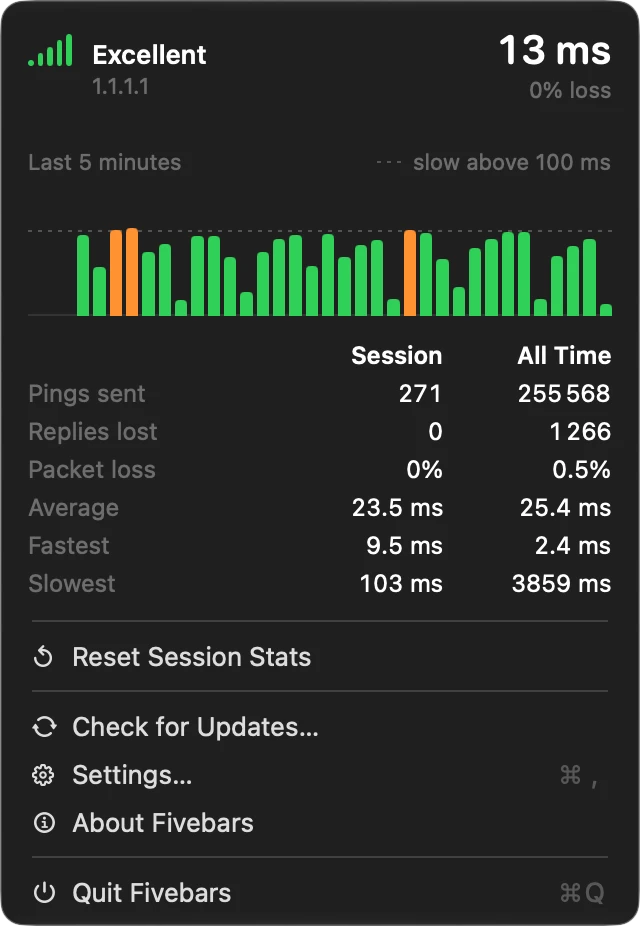

# Fivebars

Fivebars puts your internet connection in the Mac menu bar: five signal bars and your latest
ping time, updated every second. All five bars means fast and steady; fewer means slow or lost
pings. A native Swift app for Apple silicon Macs running macOS 14 or later. No account, no
tracking: it pings one host you choose and checks for updates once a day.

<p align="center"></p>

- **Download**: <https://callingcodes.com/fivebars/download/latest> (notarized DMG; the app
  then updates itself through Sparkle)
- Website: <https://callingcodes.com/fivebars> (support: <https://callingcodes.com/fivebars/support>,
  privacy: <https://callingcodes.com/fivebars/privacy>)
- Bundle identifier: `com.callingcodes.fivebars`
- Developer: Calling Codes

## Features

- Menu bar item with five signal bars and the latest ping time: `23ms` under 100 ms, then
  seconds with one decimal (`0.1s` to `9.9s`), so the ping is always four characters wide.
  Optionally `23ms (4%)` with recent packet loss. A warning triangle and `Failed` when the
  connection is down. The item keeps one fixed width for the current display settings, so
  the icons next to it never shift.
- Tooltip: latest ping time and recent packet loss.
- Left click opens a popover: quality word (Excellent / Good / Fair / Poor / Very poor), host and
  resolved address, a 5-minute latency chart (lost pings marked in red, dashed line at the slow
  ping threshold), and Session vs All Time statistics (pings sent, replies lost, packet loss,
  average / fastest / slowest), with reset actions.
- Right click opens a small menu: the current status, Reset Session Stats, Settings, About,
  Check for Updates…, Quit.
- Software updates through Sparkle 2: a daily check, and you are asked before anything is
  installed (automatic installs can be turned on in Settings).
- Optional "Connection down" / "Connection restored" notifications.
- Launch at login.
- Unprivileged ICMP (no root, no helper): IPv4 and IPv6.
- Recovers on its own after sleep/wake, network changes (Wi-Fi switch, VPN, cable) and DNS
  failures.

## How quality is measured

- One ICMP echo per second to the configured host. Pings from the last 30 s form the window.
- Each ping gets a score:
  - round-trip time at or below the **slow ping threshold** (default 100 ms): 1;
  - between the threshold and threshold + 900 ms: falls linearly from 1 to 0, and keeps
    falling (down to -2.5) past that;
  - no reply after the ping timeout (4 s): lost, -2.5;
  - an unanswered ping still younger than threshold + 900 ms is not scored yet.
- The window score is a weighted mean in which each newer ping weighs 1.2x the one before it.
- Bars = `min(floor(clamp(score, 0, 1) * 5), 4) + 1`, so 1 to 5 bars.
- Packet loss = lost pings / pings in the window.
- A running connection is declared down when no reply arrived for timeout + 4 s (8 s by
  default); the pinger is then restarted (re-resolving the host) until replies come back, at
  least every 15 s.
- At launch, after wake, after a network change or a host change, a failed start (DNS not ready,
  no socket) is retried quietly for a 10 s grace period first. So an unresolvable host shows
  `Failed` after about 14 s, not 8 s. A lookup still running after 10 s is abandoned and retried.

## Build from source

Requires Xcode 16 or later (Swift 6 toolchain) on an Apple silicon Mac.

```sh
scripts/build-app.sh            # builds build/Fivebars.app (release, arm64, ad-hoc signed)
scripts/build-app.sh --install  # also quits a running copy and installs to /Applications
swift test                      # runs the FivebarsCore unit tests
```

`swift run Fivebars` works for quick iteration, but notifications, launch at login and updates
need the bundled app.

The version lives in one place, the `VERSION` file (`major.minor.patch`). `build-app.sh` writes it
to `CFBundleShortVersionString` and derives `CFBundleVersion` from it (major × 10000 + minor × 100 +
patch, so 2.0.1 is build 20001), which keeps Sparkle's build numbers growing with no second number
to maintain. `VERSION=0.9.0 scripts/build-app.sh` builds another version without editing the file.

## First run

- Fivebars has no Dock icon; look for the bars in the menu bar.
- **Notifications**: permission is requested when you turn on Connection Up/Down Alerts in
  Settings. If you declined, re-enable it in System Settings > Notifications > Fivebars.
- **Launch at login**: uses `SMAppService`. If macOS asks for approval, Fivebars opens
  System Settings > General > Login Items; enable Fivebars there. Install to /Applications first
  so the registered login item points at a stable location.
- **Other Macs**: a build from `scripts/build-app.sh` is ad-hoc signed, not notarized (releases
  from `scripts/release.sh` are notarized and open normally). A copy downloaded or transferred to
  another Mac is quarantined: Control-click the app and choose Open, or on newer macOS use
  System Settings > Privacy & Security > Open Anyway. Alternatively:
  `xattr -dr com.apple.quarantine /Applications/Fivebars.app`.

## Settings

Settings window: host to ping (applied on Return or when the field loses focus), slow ping
threshold (50 to 2000 ms, step 10), display (Icon and Text / Icon Only / Text Only), packet loss
text, connection alerts, launch at login, check for updates automatically, install updates
automatically, Last Checked with Check Now, Restore Default Settings.

Stored in the `com.callingcodes.fivebars` user defaults domain:

| Key | Type | Default | Meaning |
|-----|------|---------|---------|
| `Hostname` | string | `1.1.1.1` | Host to ping (name or address) |
| `SlowPingLowThreshold` | number (ms) | `100` | Slow ping threshold |
| `PingTimeout` | number (s) | `4` | Ping timeout; no UI, set with `defaults` |
| `ShowIcon` | bool | `true` | Show bars |
| `ShowText` | bool | `true` | Show ping time |
| `ShowPacketLossText` | bool | `false` | Append `(n%)` to the title |
| `ShowNotifications` | bool | `false` | Connection up/down alerts |

Example: `defaults write com.callingcodes.fivebars PingTimeout -float 2` (then restart Fivebars).

Sparkle keeps its own keys in the same domain (`SUEnableAutomaticChecks`, `SUAutomaticallyUpdate`,
`SULastCheckTime`, ...). The defaults it starts from are in `Resources/Info.plist`: the feed
`https://callingcodes.com/fivebars/appcast.xml`, the public EdDSA key, daily checks
(`SUScheduledCheckInterval` 86400), no automatic install, no system profile. Update checks send the
User-Agent `Fivebars/<version> Sparkle/<version> macOS/<major.minor>`, which callingcodes.com counts
anonymously. To test against another feed:
`defaults write com.callingcodes.fivebars SUFeedURL http://127.0.0.1:8765/appcast.xml` (and
`defaults delete com.callingcodes.fivebars SUFeedURL` afterwards).

Launch at login is not a defaults key; it is the `SMAppService` registration state. Restore
Default Settings does not change it.

## Statistics storage

All-time statistics are kept per host in
`~/Library/Application Support/Fivebars/stats.json` (sent, replied, lost, average, fastest,
slowest), saved every 20 s, on host change and at quit. Session statistics live in memory only.
Pings sent and lost are not counted while the connection is down.

## Releasing

Releases are notarized, signed for Sparkle and served from callingcodes.com by
`scripts/release.sh`. The process, the dry runs and the one-time setup are in
[docs/RELEASING.md](docs/RELEASING.md).

## Design choices

- Average ping time is a true running mean.
- No "Connection down" notification at launch, and no false alarm after waking from sleep.
- An empty scoring window (no ping old enough to score) does not flag the connection as
  failed; only the watchdog or a pinger error (DNS, socket) does.
- Default host is `1.1.1.1`.
- Restarts pinging on network path changes and after wake, instead of waiting for the watchdog.
- Bars are drawn as template images, so they match light/dark menu bars and any scale.
- Launch at login uses `SMAppService` and works from any location.
- Shows DNS / socket errors in the popover and settings.

## Project layout

```
Package.swift                     SwiftPM, macOS 14+, Swift 6
Sources/FivebarsCore/             UI-free logic (unit tested)
  QualityScorer.swift             scoring, weighting, bar mapping, monotonic clock
  StatCounter.swift               statistics + JSON store
  PingLedger.swift                books each ping's outcome against session / all-time counters
  ConnectionWatchdog.swift        up/down state machine: restarts, grace, back-off, alerts
  DownReason.swift                typed reason the connection is down (no host, no network, ...)
  Pinger.swift                    unprivileged ICMP echo (SOCK_DGRAM)
  AddressSelector.swift           picks which resolved address to ping, falls back on failure
Sources/Fivebars/                 the app
  FivebarsApp.swift               entry point, AppDelegate, notifications, launch at login
  Updater.swift                   Sparkle updater, User-Agent, update settings
  MainMenu.swift                  hidden main menu carrying standard shortcuts (paste, close)
  Monitor.swift                   timers, watchdog wiring, sleep/wake, network changes
  Preferences.swift               UserDefaults-backed settings
  Presentation.swift              shared wording and colours for the UI
  StatusItemController.swift      menu bar item, icon drawing, context menu
  PanelView.swift                 popover (chart, stats)
  SettingsView.swift              settings window
Tests/FivebarsCoreTests/          Swift Testing tests
  FivebarsCoreTests.swift         scoring, stats, ICMP packets, ledger, address selection
  ConnectionWatchdogTests.swift   outage detection, sleep/wake, network churn, alerts
Resources/Info.plist              bundle metadata (LSUIElement)
VERSION                           the version (single source)
scripts/build-app.sh              build, embed Sparkle, sign, install
scripts/release.sh                release: notarize, zip, DMG, appcast, R2 upload
docs/RELEASING.md                 the release process and one-time setup
release-notes/<version>.html      written per release, embedded in the appcast
site/                             landing, privacy and support pages
```

## Known limitations

- **Very slow DNS**: if your resolver always takes more than 10 s to answer and never caches the
  answer, Fivebars keeps abandoning the lookup and shows `Failed`. With normal resolvers the
  retry is answered from cache at once.
- **Hosts with several addresses**: if one address answers, but slower than the ping timeout
  (4 s), Fivebars may keep using it and show a very poor connection instead of trying a healthy
  address of the same host.
- **Network change during a slow lookup**: on a very slow link (replies of 2 s or more), a network
  change while the host is still being looked up can show a brief false `Failed` (about 5 s)
  before it recovers.

## License

MIT, see [LICENSE](LICENSE).
